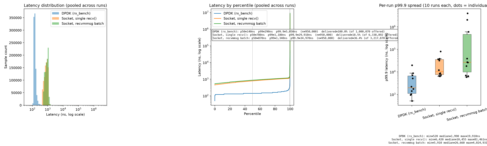
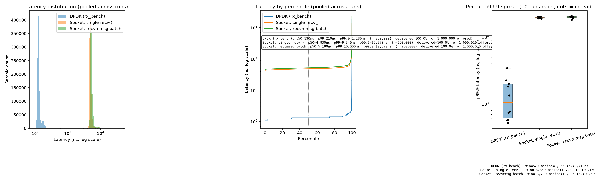

# hotpath

## Overview
hotpath is a header-only C++ library for low-latency packet receive. It compares three ways of getting packets from a NIC into
an application: DPDK kernel bypass, Linux `recv()`, and batched `recvmmsg()`. In each case a receive thread hands packets to a
consumer core through a lock-free SPSC ring buffer. The backends share one receive/consume loop built with CRTP, and the
single vs. batch socket mode is chosen at compile time.

At identical load, DPDK delivers a packet to the consumer in 130 ns at p50, against about 4.8 µs for the socket path measured from
the kernel's own receive timestamp. Under full load DPDK drops nothing while the socket path falls behind and drops packets.

## Benchmark
We are using two QEMU virtual machines to benchmark the pipeline. The first virtual machine is running PKTGEN and is writing packets
to the MAC address of the second VM. The second VM has two threads running where one thread is constantly consuming from the NIC and
pushing those packets read straight to the SPSC queue. The other thread then pops from the SPSC queue and reads the start time from
those packets to get the latency from the packet first being seen by software to the consumer popping it from the queue and the data being usable.
Where that start time is taken depends on the path:
- **DPDK:** the receive thread stamps packets with the rdtsc counter right after `rte_eth_rx_burst` returns. With busy polling this is the
earliest point software sees the packet (virtio has no hardware timestamps). By taking the inverse of the counter's frequency we get the
time taken in seconds per cycle, and multiplying this by 1e9 gives us the time taken in ns.
- **Sockets:** the kernel stamps each packet when it enters the network stack (`SO_TIMESTAMPNS`), and the receive thread reads that
timestamp back from `recvmsg`/`recvmmsg`. The measured window therefore includes the whole kernel receive path: waiting in the socket
buffer, waking the receive thread, copying the data and returning from the syscall. The consumer reads `clock_gettime(CLOCK_REALTIME)`,
the same clock the kernel timestamp uses.

The plot under [Benchmark Results](#benchmark-results) was recorded with an earlier version that stamped socket packets after
`recv`/`recvmmsg` returned. The kernel-timestamp results are in [Measuring the kernel receive path](#measuring-the-kernel-receive-path).
All raw data is in [analysis/runs](analysis/runs/README.md). There are three pipelines we are comparing. 
- The one we expect to perform the best is the DPDK kernel bypass pipeline that uses a busy polling approach to read from the NIC. It is using rte_eth_rx_burst to read batches/bursts
of packets from the NIC. These are then pushed as a batch to the SPSC ring and popped from the ring as a batch.
- The next is a simple socket based approach, that uses the recv system function to read from the socket. The single version of this
is reading from the socket one packet at a time and pushing to the ring one at a time. We then pop each item from the ring one at
a time and process it. recv under the hood is **interupt based** because it puts the thread to sleep when you call it. When data
arrives at the NIC a physical CPU interrupt triggers the OS network driver wake the thread and copy the data. 
- The last approach is the same simple socket approach, but we are trying to read from the NIC in batches similar to how rte_eth_rx_burst
reads in bursts. We then push and pop these bursts from the SPSC ring using its push/pop batch functions. 
## Benchmark Results

## Analysis
We can see here that the DPDK-based implementation clearly has the best p50 latency and tail latency, and it is the only path that
delivered every offered packet (0% dropped vs. 64–82% for the socket paths). The drop rate and throughput gap is where the kernel bypass
shows up directly: every packet the socket path receives has to go through the kernel stack, which caps how fast it can drain the NIC.
When we use recv or recvmmsg we must do the following steps per call:
1. Switch from userspace to kernel space
2. Kernel grabs file-descriptor for the socket from process file-descriptor table
3. Socket buffer is locked so not corrupted during read
4. Data is copied from kernel's sk_buff to user space pointer
5. Kernel cleans up (free sk_buff, unlock socket, update TCP window sizes)
6. Switch back to usermode from kernel mode
If the buffer is empty after step 3 **additionally**:
1. Thread is descheduled and removed from active run-queue
2. CPU does a full context switch 
3. The thread is woken up and rescheduled once network softirq finishes with packet
4. Resume on step 4 from above

We are able to skip this using DPDK. The NIC driver is running in userspace using vfio, and the packets are transferred from the NIC via direct memory access (DMA) into the 
ring of descriptors fed into the queue created with rte_eth_rx_queue_setup. When we call rte_eth_rx_burst() we aren't performing a syscall, it just reads the descriptor rings
that have already been written by the NIC. We are skipping the interrupt, context switch, copy, and thread descheduling (while waiting for something to come).
This is why DPDK keeps up with the offered load when the sockets can't. There is an inherent tradeoff we see between the recv()/recvmmsg() implementations. They either have a low discovery latency, but
have to pay the cost of the syscall each time OR have less syscalls via batching with the con of earlier packets in each batch being stale. rte_eth_rx_burst doesn't have this
cost to deal with; So it can read from the nic constantly in a busy poll loop to get fast discovery latency, while also picking up many packets per call. It doesn't have to 
choose one.

### Measuring the kernel receive path
The first version of the benchmark (the plot above) stamped socket packets after `recv`/`recvmmsg` returned, so the kernel steps above
happened before the clock started. That version only measured the hand-off through the ring to the consumer (140ns vs ~780ns p50).
The socket path now uses the kernel's own receive timestamp (`SO_TIMESTAMPNS`). The kernel records the time when the packet enters the
network stack and hands it back alongside the packet, so the socket numbers below include every kernel step listed above.

The start points are as close as each path allows, but they aren't identical. Neither includes time the packet spends in the virtio
receive ring before software picks it up. The kernel stamp is taken after the interrupt has been delivered and packet processing has
started, so interrupt delivery, which DPDK avoids entirely, is still outside the socket window. If anything, the socket numbers understate
the full cost of the socket path.

**Same traffic for both paths** (Pktgen at 0.1% rate, burst 1, so packets arrive one at a time. 10 runs of 95,000 samples each, pooled):

| Path | p50 | p99 | p99.9 | Dropped |
|---|---|---|---|---|
| DPDK | 130 ns | 210 ns | 1.28 µs | 0% |
| Socket, single `recvmsg()` | 4.83 µs | 9.34 µs | 19.4 µs | 0% |
| Socket, `recvmmsg` batch | 5.18 µs | 10.0 µs | 19.9 µs | 0% |



At identical load DPDK is about 37x faster at p50 and 44x faster at p99 than the best socket path. Getting one packet through the
kernel and waking the thread blocked in `recvmsg` (which in a VM also means the hypervisor rescheduling that vCPU) costs about 4.8 µs.
The batch path is about 350 ns slower when only one packet is waiting: `recvmmsg` still resets its 32 message headers and checks for
more packets after the first one arrives, which is batching overhead with nothing to batch.

**Higher load:**
- At 1% rate with Pktgen's default burst of 32, socket p50 rose to about 40 µs (39.8 µs single, 42.4 µs batch) with 0 drops. `N_DIST`
shows packets arriving 32 at a time, so each one waits behind the rest of its burst. Both the rate and the burst size changed between
this run and the one above, so the increase can't be pinned on one of them alone.
- At full rate the socket path can't keep up: it drops 58–75% of packets, and the packets that do get through wait 69 ms (batch) and
113 ms (single) at p50. That is time spent queued in the 8 MB receive buffer from the [Packet Loss](#packet-loss) section. Latency
multiplied by drain rate comes to about 16k packets queued ahead of each one in both modes, roughly what 8 MB holds. Raising
`SO_RCVBUFFORCE` cut drops by about 20 points but added tens of milliseconds of queueing delay. DPDK at full rate drops nothing and stays at
140 ns p50 / 290 ns p99.

The kernel timestamp is in `CLOCK_REALTIME`, so the consumer reads the same clock. Unlike `CLOCK_MONOTONIC_RAW`, `CLOCK_REALTIME` can be
stepped by NTP mid-run, which would corrupt the samples it lands on. To rule that out, time sync is disabled on the receiving VM for the
duration of the runs:
```bash
sudo timedatectl set-ntp false   # before benchmarking
sudo timedatectl set-ntp true    # after
```

### Packet Loss
Now when we compare the two socket based implementation's we have to note something interesting. When I first ran the numbers with
the recvmmsg implementation of the socket, I was disappointed. It consistently lagged behind the single packet recv implementation in terms
of latency, ie ~100ns on the p50. I was concerned that the batch implementation wasn't showing up as faster because there wasn't enough
traffic reach the VM (wasn't sure if there was some bottleneck somewhere between the two VM's I wasn't aware of). To fix this, I logged the packets dropped
and found that actually we were dropping around 78% of our packets. This means the problem with our batch wasn't that we weren't getting enough packets.
What I first did to lower the amount of packets being dropped, was set the SO_RCVBUFFORCE linux socket option to 8MB, so the socket is allowed to have more
data pile up before its dropped. This reduced the percentage dropped from about 78% to about 58%. When we account for the packets dropped for the single recv socket
numbers we get a different story between the two implementations: across the 10 baseline runs, single `recv()` dropped 81.5% of offered packets
and `recvmmsg` batch dropped 63.6%, so the single-packet latencies only describe the fastest-handled 18.5% of the traffic.

The kernel's packet counter (`tp_packets` from `PACKET_STATISTICS`) already includes the dropped packets, so the drop rate is
`dropped / offered`. An earlier version of this README added the drops to that counter a second time, which made every drop rate look
lower (44% here instead of 78%). You can see the counter includes drops from the numbers themselves: offered minus dropped comes out to
the ~100k packets each run processed (plus ~17k still sitting in the 8MB buffer in the "After" runs).

**Batched Packet Loss**

| Period | Offered (`tp_packets`) | Dropped  | Percent Dropped (dropped / offered) |
|---|---|----------|-------------------------------------|
| Before 1 | 491,120 | 390,891  | 79.6%                               |
| Before 2 | 423,800 | 323,572  | 76.4%                               |
| Before 3 | 480,754 | 380,531  | 79.2%                               | 
| Before Avg | — | —  | ~78.4%                              | 
| After 1 | 304,889 | 187,412  | 61.5%                               | 
| After 2 | 301,312 | 183,835  | 61.0%                               |
| After 3 | 243,189 | 125,712  | 51.7%                               | 
| After Avg | — | — | ~58.1%                              |  

### recv() vs recvmmsg()
What we see in these numbers from the latency by percentile is a couple of things:
1. recv (single) sees more raw offered packets in absolute terms because it's throughput-limited (one packet per call), so it takes longer in total time to execute
the 95,000 iteration run. This means over the duration of the run, more packets are seen and dropped.
2. Of this greater number of packets sent during the run, the percentage dropped by the recv (single) is more still compared to recvmmsg (batch). The recvmmsg runs
delivered 36.4% of offered packets against 18.5% for single recv, about twice the share.
3. If we set vlen to 1 in the recvmmsg() parameters we get these numbers: \
vlen=1 batch p50 values (10 runs): 780, 780, 790, 790, 780, 780, 790, 790, 780, 790 → average ≈ 785ns \
vlen=1 batch p99 values: 1140, 1180, 1320, 1300, 1250, 1130, 1130, 1220, 1250, 1130 → average ≈ 1205ns \
Single recv() pooled (n=950,000): p50=780ns, p99=1,180ns \
This is interesting because we can see this pulls the batched number right inline with the single socket p50 and p99 numbers. There is real overhead added by using 
recvmmsg as it has to allocate and copy the mmsghdr struct that recv doesn't. The difference this adds is not detectable with our noise floor.

| Config | Wall-clock duration | recvmmsg calls/run | % calls returning full batch | Max `rx_ring` occupancy (of 4096) |
|---|---|---|---|---|
| Batch, vlen=32 | 0.385s – 2.222s (avg ≈0.59s) | ~3,125 | ~100% (n=32 nearly every call) | 32–64 typical, one run hit 1,632 |
| Batch, vlen=1 | 0.919s – 1.009s (avg ≈0.96s) | 100,000 | 100% (forced, n=1 capped) | 2–45 |
| Single recv() | 0.758s – 0.841s (avg ≈0.80s) | N/A (not recvmmsg) | N/A | 3–52 |

4. When we ran with the number of elements received from each recvmmsg() call we saw that actually basically always we were pulling 32 elements. What this means is that batching
was being fully utilized but vlen(32) was slower than vlen(1) per packet. That could either the extra cost of the recvmmsg() overhead that scales with vlen or it could be
just an artifact of how we are recording per packet. Even though we are seeing a worse per-packet latency, vlen=32 finishes the run in half the wall clock duration. This is
because there are fewer recvmmsg() calls for the same work, which is the batching tradeoff we make: better aggregate throughput, but worse per packet latency.
5. The p99.9 and max latency numbers are in large millisecond ranges that we also see in the DPDK bench. We have determined they aren't rx_ring occupancy by the table above
as those outliers still exist with rx_ring occupancy very low relative to its total size. This means there's no pressure filling up the rx_ring causing latency spikes. Some of it
we were able to trace to the host CPU scheduling underlying these vCPUs. Running perf sched trace we found a max delay of 2.6ms, which is only part of the 7ms we were tending to see.
The max and p99.9 numbers are being heavily affected by noise in the test environment ie don't have core isolation configured on the host. We have configured the vCPU's threads to only run on those cores, but
we haven't done anything to prevent the OS from scheduling other things its wants on those cores.
For comparing recv, dpdk and recvmmsg, use the p50 and p99 numbers as the reliable comparison.
## Local Setup
**Create the isolated network:**

```bash
cat > pktgen-isolated.xml <<'EOF'
<network>
<name>pktgen-isolated</name>
<bridge name='virbr-pktgen' stp='off' delay='0'/>
</network>
EOF
sudo virsh net-define pktgen-isolated.xml
sudo virsh net-start pktgen-isolated
sudo virsh net-autostart pktgen-isolated
```

This is a private, direct wire without NAT, this is to remove the noise of other things going on my computers default network

### QEMU Setup:

**Install command:**

`sudo pacman -S qemu-full libvirt virt-manager dnsmasq edk2-ovmf
`

**Enable libvrt daemon:**

`sudo systemctl enable --now libvirtd.service
`

Add your user to the libvirt and kvm groups so you can manage VMs and access /dev/kvm without sudo:

`sudo usermod -aG libvirt,kvm $USER
`

**Validate:**

`virt-host-validate qemu
`

**Login:**

**1. From your host terminal (not inside the VM), run:**

```bash
   virt-install \
   --name dpdk-vm \
   --memory 4096 \
   --vcpus 2 \
   --disk size=20 \
   --cdrom /var/lib/libvirt/images/ubuntu-26.04-live-server-amd64.iso \
   --os-variant ubuntu24.04 \
   --network network=default,model=virtio \
   --graphics spice
```
`sudo virsh net-dhcp-leases default
`

**2. Confirm you see an IP for dpdk-vm, then SSH in from the host:**

`ssh <your-username>@<that-ip>
`

**3. Once that SSH session works, close the virt-viewer window**

**Run in the VM:**

```bash
sudo apt update && sudo apt install -y \
git build-essential meson ninja-build python3-pyelftools \
libnuma-dev pkg-config
```
**What each piece is for:**

- build-essential — gcc/g++/make, the basic C/C++ toolchain DPDK needs to compile.
- meson + ninja-build — DPDK switched its build system to Meson+Ninja years ago (no more make config && make like old versions); this is what actually drives the DPDK build.
- python3-pyelftools — DPDK's build scripts use this to inspect compiled binaries (symbol/ELF section analysis) as part of the build process.
- libnuma-dev — DPDK is NUMA-aware (it cares which memory node a core's traffic lives on) even though your VM is single-socket/no real NUMA; the library headers are still a hard build dependency.
- pkg-config — standard Linux convention for libraries to advertise their compile/link flags; DPDK both consumes and provides .pc files.
- git — to actually clone the DPDK source repo, which we'll do next.

**Allocate the hugepages**

```bash
echo 1024 | sudo tee /sys/kernel/mm/hugepages/hugepages-2048kB/nr_hugepages
grep Huge /proc/meminfo
```

Attach the second NIC:

```bash
virsh -c qemu:///system attach-interface \
  --domain dpdk-vm \
  --type network \
  --source pktgen-isolated \
  --model virtio \
  --config --live
```
**Then rebind the NIC:**
```bash
cd ~/dpdk
sudo modprobe vfio_pci
echo Y | sudo tee /sys/module/vfio/parameters/enable_unsafe_noiommu_mode
sudo ./usertools/dpdk-devbind.py --bind=vfio-pci 0000:07:00.0 --force
./usertools/dpdk-devbind.py --status
```
**Build DPDK:**
```bash
git clone https://github.com/DPDK/dpdk.git ~/dpdk
cd ~/dpdk
meson setup builddir
ninja -C builddir
sudo ninja -C builddir install
sudo ldconfig
```

### Pktgen VM Setup

1. Create pktgen-vm:
   ```bash
    virt-install \
    --name pktgen-vm \
    --memory 4096 \
    --vcpus 2 \
    --disk size=20 \
    --cdrom /var/lib/libvirt/images/ubuntu-26.04-live-server-amd64.iso \
    --os-variant ubuntu24.04 \
    --network network=default,model=virtio \
    --graphics spice

    sudo virsh net-dhcp-leases default
    ```
2. Attach the second NIC:

    ```bash
    virsh -c qemu:///system attach-interface \
   --domain pktgen-vm \
   --type network \
   --source pktgen-isolated \
   --model virtio \
   --config --live
    ```
3. SSH in, then install the same DPDK build deps as dpdk-vm:

    ```bash
   sudo apt update && sudo apt install -y \
   git build-essential meson ninja-build python3-pyelftools \
   libnuma-dev pkg-config
    ```
4. Allocate hugepages (identical to dpdk-vm):

    ```bash
   echo 1024 | sudo tee /sys/kernel/mm/hugepages/hugepages-2048kB/nr_hugepages
   grep Huge /proc/meminfo
    ```
5. Build DPDK 
    ```bash
   git clone https://github.com/DPDK/dpdk.git ~/dpdk
   cd ~/dpdk
   meson setup builddir
   ninja -C builddir
   sudo ninja -C builddir install
   sudo ldconfig
    ```
6. Clone and build Pktgen-DPDK: 
    ```bash
   git clone https://github.com/pktgen/Pktgen-DPDK.git ~/Pktgen-DPDK
   cd ~/Pktgen-DPDK
   meson setup builddir
   ninja -C builddir
    ```
7. Bind the NIC to vfio-pci (same as dpdk-vm):
    ```bash
   sudo modprobe vfio_pci
   echo Y | sudo tee /sys/module/vfio/parameters/enable_unsafe_noiommu_mode
   cd ~/dpdk
   sudo ./usertools/dpdk-devbind.py --bind=vfio-pci 0000:07:00.0 --force
   ./usertools/dpdk-devbind.py --status
    ```
8. Run it:
    ```bash
   cd ~/Pktgen-DPDK
   sudo ./builddir/app/pktgen -l 0,1 -n 4 -a 0000:07:00.0 -- -P -T -m "1.0"
    ```
   
**In DPDK VM Clone hotpath:**

```bash
git clone https://github.com/jamesn14/hotpath ~/hotpath
```
Build rx_bench:

```bash
cd ~/hotpath/dpdk_rx_app
cmake -B cmake-build-dpdk-vm
cmake --build cmake-build-dpdk-vm --target rx_bench
```
Build socket_bench:

```bash
cd ~/hotpath/socket_rx_app
cmake -B cmake-build-dpdk-vm
cmake --build cmake-build-dpdk-vm --target socket_bench
```
`rx_bench` needs the NIC on `vfio-pci`:

```bash
sudo dpdk-devbind.py --bind=vfio-pci 0000:07:00.0
cd ~/hotpath/dpdk_rx_app/cmake-build-dpdk-vm
sudo ./rx_bench -l 0,1 -n 4 -a 0000:07:00.0 -- 5000 100000
```

`socket_bench` needs the NIC on `virtio-pci`:
```bash
sudo dpdk-devbind.py --bind=virtio-pci 0000:07:00.0
cd ~/hotpath/socket_rx_app/cmake-build-dpdk-vm
sudo ./socket_bench enp7s0 5000 100000 single
sudo ./socket_bench enp7s0 5000 100000 batch
```
If you want to run the versions that pool over 10 runs do use these instead
```bash
~/hotpath/scripts/run_repeated.sh 10 rx_bench_latencies.csv runs/rx_bench -- sudo ./rx_bench -l 0,1 -n 4 -a 0000:07:00.0 -- 5000 100000
```
```bash
~/hotpath/scripts/run_repeated.sh 10 socket_bench_batch_latencies.csv runs/socket_batch -- sudo ./socket_bench enp7s0 5000 100000 batch
```
```bash
~/hotpath/scripts/run_repeated.sh 10 socket_bench_single_latencies.csv runs/socket_single -- sudo ./socket_bench enp7s0 5000 100000 single
```
If you do that pull the csv files into analysis/runs and run `python3 plot_latencies.py`